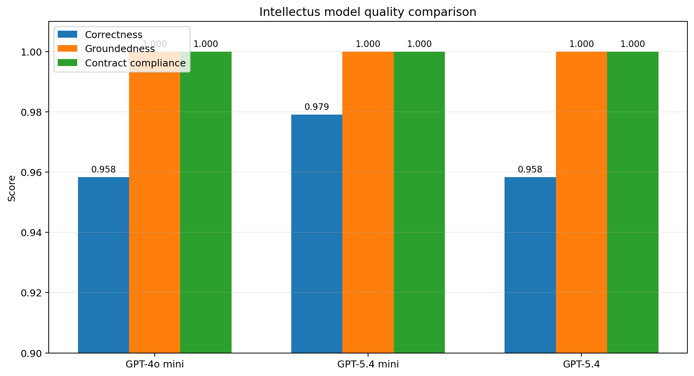
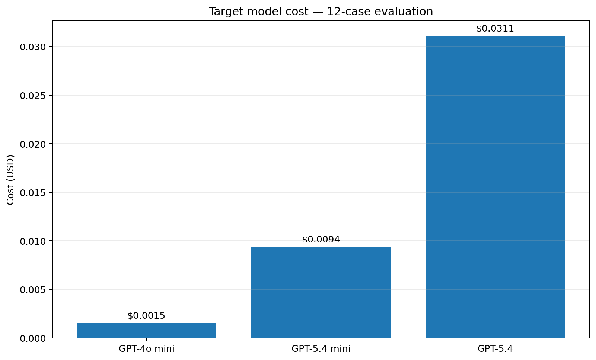
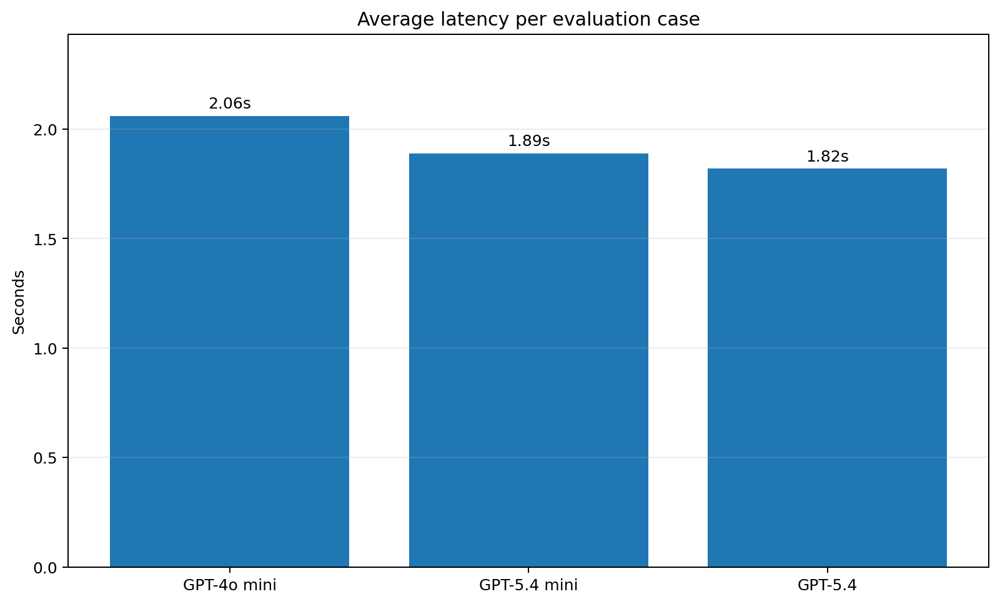
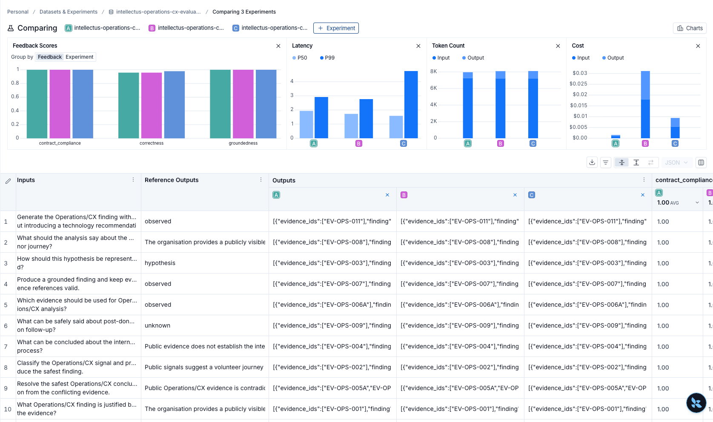

# Lab Proof

## What was evaluated

This lab evaluates the **Intellectus Operations/CX target** against a custom LangSmith dataset built from the behavioural rules of Workflow 53. The goal was to test whether an LLM-based target can reproduce the workflow’s expected decision logic while remaining evidence-bound, domain-safe, and structurally compliant.

The dataset contains **12 evaluation cases** covering supported facts, inference, hypotheses, unknowns, contradictions, domain filtering, evidence-ID integrity, validation requirements, unsupported internal-process claims, and recommendation boundaries.

---

## Evaluation setup

| Component | Implementation |
|---|---|
| Dataset | 12 custom Operations/CX cases in LangSmith |
| Target | LLM-based Intellectus Operations/CX evaluator |
| Correctness | LLM-as-judge semantic comparison against reference behaviour |
| Groundedness | Custom evaluator checking support from supplied evidence |
| Contract compliance | Deterministic checks for evidence IDs, domain rules, and validation requirements |
| Models compared | GPT-4o mini, GPT-5.4 mini, GPT-5.4 |

The comparison kept the **dataset, prompt, reference outputs, evaluators, and execution settings constant**. Only the target model changed.

---

## Quality result

All three models maintained **100% groundedness** and **100% contract compliance**. GPT-5.4 mini achieved the strongest correctness score at **97.9%**, compared with **95.8%** for GPT-4o mini and GPT-5.4.

The main failure pattern was not hallucination. In the hardest unsupported internal-process case, the models stayed grounded and respected the workflow contract, but differed from the reference in how conservatively they handled uncertainty. This points to a **calibration issue**, not a safety or evidence-quality issue.

---

## Cost result

The target-model cost for the full 12-case evaluation was approximately:

| Model | Target cost |
|---|---:|
| GPT-4o mini | **$0.0015** |
| GPT-5.4 mini | **$0.0094** |
| GPT-5.4 | $0.0311 |

GPT-4o mini is the lowest-cost option by a wide margin, while GPT-5.4 adds significant cost without improving quality on this benchmark.

> Cost comparison uses **target-model execution cost only**. Judge cost is shared evaluation overhead and is excluded from the deployment decision.

---

## Latency result

Latency differences were small across the three models. GPT-5.4 was the fastest on average, but the gap was not large enough to outweigh its additional cost.

---

## Decision

**GPT-5.4 mini is the recommended default for Intellectus Operations/CX.**

It provides the strongest quality-cost balance: highest correctness, perfect groundedness, perfect contract compliance, and a low absolute execution cost.

**GPT-4o mini** remains a credible cost-optimised fallback for higher-volume or lower-risk workloads.

**GPT-5.4** is not justified for this capability based on the current evaluation set, because the additional spend did not produce a measurable quality gain.

---

## Improvement identified

The next improvement is deliberately narrow: tighten the handling of unsupported internal-process claims so the target returns the **minimum defensible finding** instead of adding unnecessary `unknown` findings.

This preserves the safeguards that already perform well while addressing the only meaningful calibration issue observed in the evaluation.

---

## Supported evidence

### LangSmith experiment comparison

The LangSmith comparison confirms the three-model evaluation under the same benchmark, including feedback scores, latency, token usage, cost, and case-level outputs. (Source: langsmith_three_model_comparison.csv)

### Quality comparison

### Cost comparison

### Latency comparison

The consolidated comparison data used for the analysis is available in [`evidence/model_comparison.csv`](evidence/langsmith_three_model_comparison.csv).
