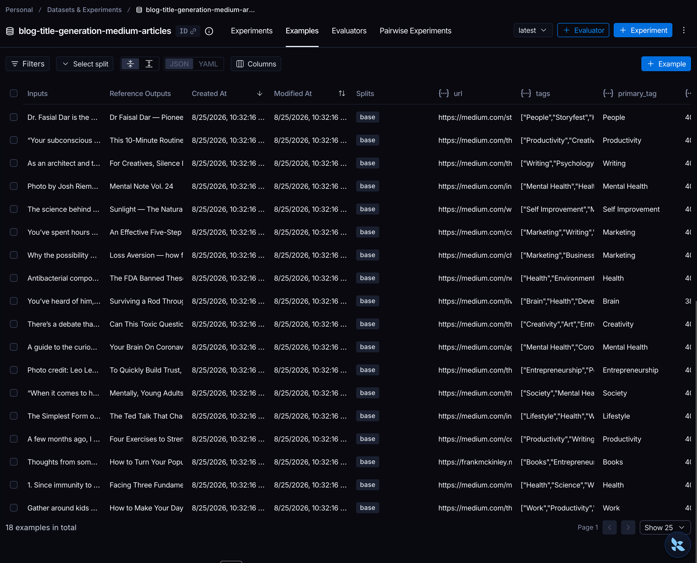
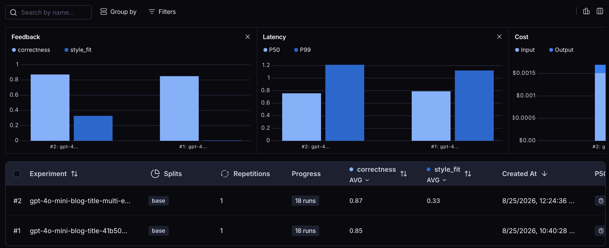
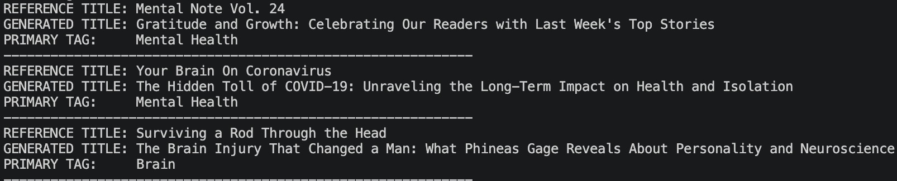
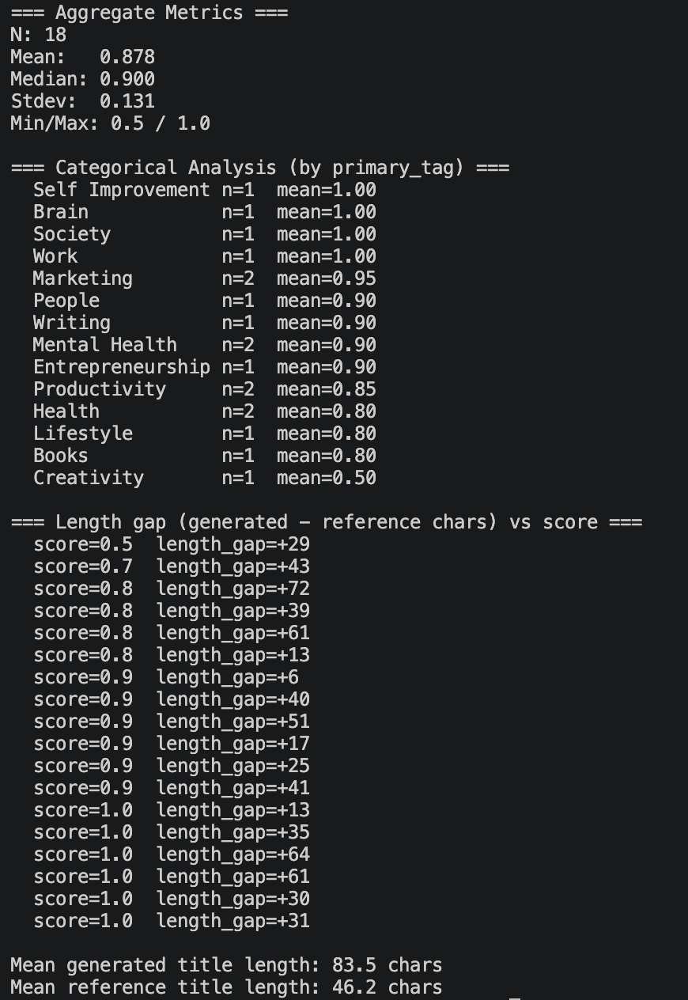

# Lab Proof: Screenshot Evidence

**Author:** Mudit Airan

## Step 4: Dataset created and verified in LangSmith

18 examples uploaded to `blog-title-generation-medium-articles`, with `inputs`, `Reference Outputs`,
and metadata (`url`, `tags`, `primary_tag`) all correctly attached to each example.

## Step 7/12: Experiments comparison in LangSmith

Both experiments side by side — `gpt-4o-mini-blog-title-41b50506` (correctness only, 0.85)
and `gpt-4o-mini-blog-title-multi-eval` (correctness 0.87 + style_fit 0.33) — with latency
and cost breakdowns per run.

## Step 5: Target function smoke test

Output of `python3 scripts/target_function.py` — reference vs. generated titles for the
first 3 examples.

## Step 9: Results analysis

Output of `python3 scripts/analyze_results.py` — aggregate metrics, categorical breakdown,
and the length-gap-vs-score check.

