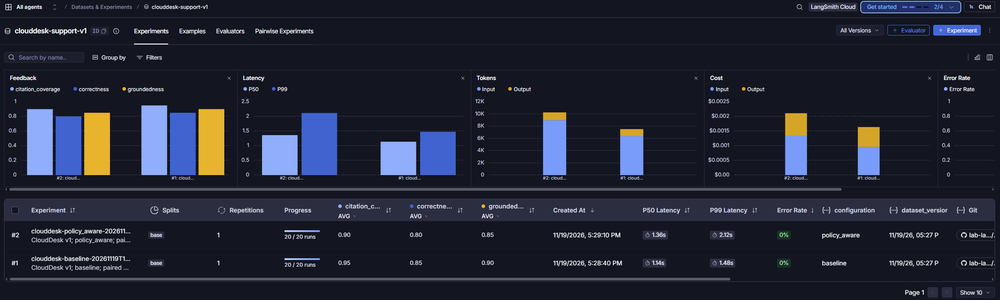
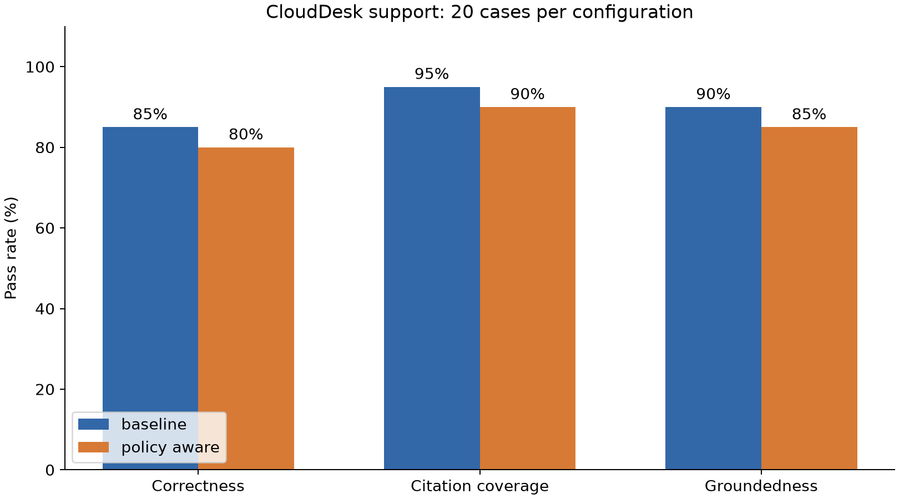
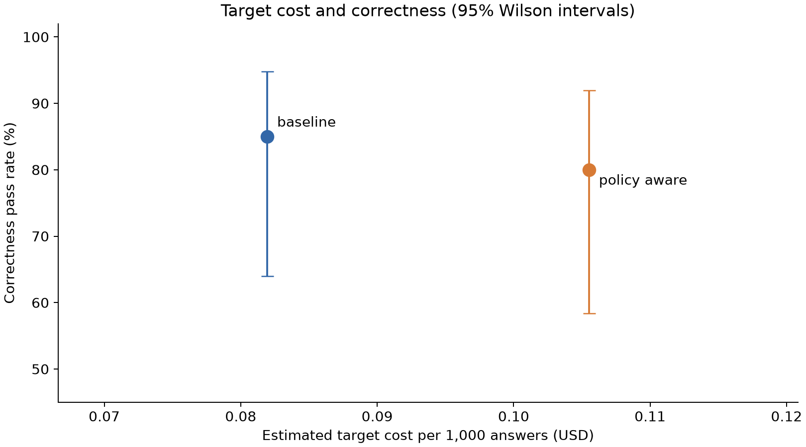

# CloudDesk support evaluation: evidence

I built and ran a LangSmith evaluation for a fictional SaaS support assistant. The completed suite contains a versioned 20-case dataset, two GPT-4o mini prompt configurations, three evaluation dimensions, and local exports of the results and nested traces. The baseline scored 85% correctness and the policy-aware prompt 80%; the reports retain both failures and judge mistakes.

## Code and workflow

[Executed notebook](clouddesk_support_evaluation.ipynb) · [Dataset and traced targets](src/evaluation.py) · [Experiment runner](src/run_experiments.py) · [Analysis](src/analyze_results.py)

The workflow validates the source-backed examples, creates or verifies the LangSmith dataset, calibrates the evaluators on five fixtures, smoke-tests three examples per target, runs both 20-case experiments, and exports scores, comments, costs, and traces. The archived run is `20261119T162817Z`. The notebook defaults to reproducing analysis from these saved live results; its live-run switch invokes the same experiment workflow.

## One observed run

- Configuration: baseline, GPT-4o mini, temperature 0, maximum 350 completion tokens.
- Example: S01, plans, easy.
- Input question: **What are the member and storage limits of Free?**
- Input context: the complete [version 1 plans policy](data/plans.md), also embedded in the [exported trace](outputs/traces/baseline_S01.json).
- Final output: **The Free plan supports a maximum of 3 members and provides 1 GB of workspace storage. Additionally, it does not include API access [PLAN-01].**
- Feedback: correctness **true**, citation coverage **true**, groundedness **true**.
- Evidence: [LangSmith trace](https://eu.smith.langchain.com/o/657b4239-b54a-49e2-8b8e-81ad7a12e669/projects/p/ded79b54-4fb4-4472-b1ce-f6fe6e227850/r/01a1f4a3-b743-7967-9287-aa7976c9ac77?poll=true) and its [local JSON export](outputs/traces/baseline_S01.json), including the child OpenAI call, input, output, timing and token usage.

## Dataset and experiment evidence

| Artifact | Evidence |
|---|---|
| Dataset | [LangSmith dataset](https://eu.smith.langchain.com/datasets/cb947ac6-2849-45de-854c-a589623941e0); [20 source-backed examples](data/support_examples.json) |
| Upload verification | [Receipt](outputs/dataset_verification.json): all input, reference and authored metadata fields match |
| Baseline experiment | [LangSmith](https://eu.smith.langchain.com/datasets/cb947ac6-2849-45de-854c-a589623941e0/compare?selectedSessions=ded79b54-4fb4-4472-b1ce-f6fe6e227850); [CSV](outputs/20261119T162817Z/results_baseline.csv) |
| Policy-aware experiment | [LangSmith](https://eu.smith.langchain.com/datasets/cb947ac6-2849-45de-854c-a589623941e0/compare?selectedSessions=5ddbec33-d0ff-4ea4-9966-9067fa05bf6c); [CSV](outputs/20261119T162817Z/results_policy_aware.csv) |
| Remote persistence | [Read-back verification](outputs/remote_verification.json): 40 target runs and 120 matching feedback scores |
| Calibration | [Five fixtures and comments](outputs/20261119T162817Z/calibration.json); [calibration metrics](outputs/calibration_metrics.csv) |
| Smoke checks | [Six successful target calls](outputs/20261119T162817Z/smoke_tests.json) |
| Comparison and costs | [Metrics](outputs/comparison_summary.csv); [successful API-call ledger](outputs/20261119T162817Z/api_usage.jsonl) |

## One failure and its limitation

Both prompts answered S19 with Friday 20:00 UTC as the response target. Support closes Friday at 17:00, so the four business hours actually end Monday at 12:00 UTC. The correctness judge caught the error; the custom groundedness judge incorrectly passed it. The [failed trace](https://eu.smith.langchain.com/o/657b4239-b54a-49e2-8b8e-81ad7a12e669/projects/p/ded79b54-4fb4-4472-b1ce-f6fe6e227850/r/01a1f4a3-b1cd-74e5-8856-da85e488b15e?poll=true), [local trace export](outputs/traces/baseline_S19.json), [judge comments](outputs/evaluator_disagreements.csv), and [policy audit](outputs/policy_audit.csv) preserve this disagreement. Five passing calibration fixtures did not establish judge reliability for calendar arithmetic.

## Interface review

[LangSmith review notes](docs/langsmith_review.md) document the experiment overview and its initial aggregation delay. [Final aggregate verification](outputs/ui_aggregate_verification.json) confirms all 20 cases per metric and the published averages.

The completed experiment overview matches the exported metrics. The dataset view shows all 20 examples with reference outputs and metadata. The S19 trace exposes the nested OpenAI call and the disagreement between correctness (0) and groundedness (1).

- [Dataset examples and metadata](outputs/screenshots/dataset_examples.png)
- [S19 input, output, reference and feedback](outputs/screenshots/baseline_S19_feedback.png)
- [S19 configuration and tracing attributes](outputs/screenshots/baseline_S19_attributes.png)

## Findings

[Evaluation summary](evaluation_summary.md) · [Optimization summary](optimization_summary.md) · [Failure analysis](docs/failure_analysis.md) · [Dataset design](docs/dataset.md) · [Evaluator design](docs/evaluators.md)

